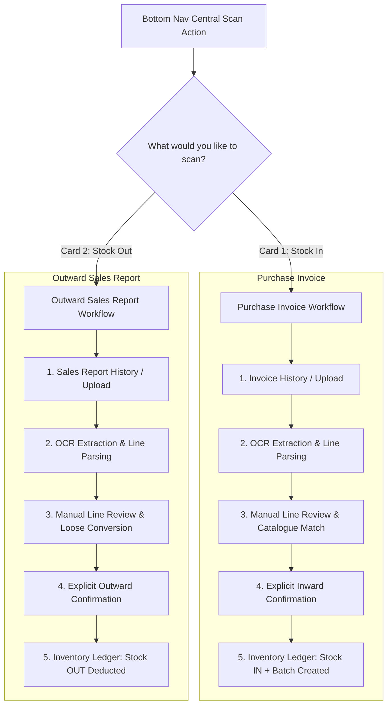

# Document Scanning & Verification Workflows (PharmaPro_GM)

## 1. Architectural Distinction: Stock In vs. Stock Out

Document scanning serves two fundamentally distinct, non-interchangeable business purposes in the pharmacy:

---

## 2. Purchase Invoice Workflow (Stock In)

### Step 1: Invoice History
- Displays supplier name, invoice number, invoice date, total amount, line count, and processing status (`DRAFT`, `PENDING_REVIEW`, `POSTED`, `REJECTED`).
- Entry action: **Scan Invoice**.

### Step 2: Capture or Upload
- Shared document capture component supporting camera photo, gallery image selection, or PDF upload.
- Displays file preview, format validation, and creates a draft record in `purchaseInvoices`.
- **Invariant**: No stock is mutated during capture or OCR extraction.

### Step 3: Review Extracted Data
- Editable invoice header (invoice number, supplier, invoice date, optional linked Purchase Order).
- Editable line items:
  - Original extracted raw text (preserved for audit trail).
  - Matched catalogue medicine (Product ID, brand name, strength).
  - Match confidence indicator (`HIGH`, `MEDIUM`, `LOW`, `UNMATCHED`).
  - Bill quantity and free/bonus quantity.
  - Unit of purchase (`strip`, `bottle`, etc.).
  - Batch number and expiry date (`YYYY-MM-DD`).
  - Purchase rate and line total.
- **Validation Rule**: Unresolved mandatory medicine lines or missing batch/expiry information strictly block confirmation.

### Step 4: Confirm Stock Inward
- Displays summary: supplier, invoice reference, matched line count, total units to add.
- Explicit confirmation prompt: *"Add this stock?"*
- Sends request with `Idempotency-Key` to `POST /api/v1/invoices/:id/confirm`.

### Step 5: Result & Ledger Posting
- Moves document status to `POSTED` only after successful inventory posting.
- Creates append-only stock inward records and updates batch balances.

---

## 3. Outward Sales Report Workflow (Stock Out)

### Step 1: Sales Report History
- Displays report date, reference, line count, status (`PENDING_REVIEW`, `POSTED`, `REJECTED`), and total sales volume.
- Entry action: **Scan Sales Report**.

### Step 2: Capture or Upload
- Captures or uploads the end-of-day sales register image or PDF.
- Computes SHA-256 file hash to prevent duplicate imports.

### Step 3: Review Extracted Lines
- Editable fields per line:
  - Extracted medicine name and raw text.
  - Matched catalogue medicine (`MED-XXXXXX`).
  - Confidence scoring:
    - **High**: $\ge 0.90$
    - **Medium**: $\ge 0.70$ and $< 0.90$
    - **Low**: $< 0.70$
  - Quantity and unit.
- **Loose Unit Conversion**: Applies catalogue conversion factors (e.g. 5 tablets = 0.5 strip where 1 strip = 10 tablets).
- Pre-posting stock check: warns if available stock is insufficient to fulfill proposed deduction.

### Step 4: Confirm Stock Out
- Displays proposed stock deductions, FEFO batch allocations, and duplicate warnings.
- Explicit confirmation prompt: *"Deduct this stock?"*
- Sends request with `Idempotency-Key` to `POST /api/v1/sales-reports/:id/confirm-and-post`.

### Step 5: Result & Ledger Audit Trail
- Moves status to `POSTED`.
- Deducts stock through append-only inventory ledger.
- If insufficient stock occurs, the entire posting attempt is rejected without partial deductions.

---

## 4. Idempotency & Concurrency Guarantees
1. Mutating endpoints require an `Idempotency-Key` header.
2. Repeating the confirmation with the same key returns the cached successful result without creating duplicate stock movements.
3. Submitting the same key with a different payload returns an idempotency conflict.
4. Duplicate invoice imports (`supplier_id` + `invoice_number`) return HTTP 409 `DUPLICATE_INVOICE`.
5. Duplicate sales reports (`report_date` + `report_reference`) return HTTP 409 `DUPLICATE_REPORT`.
