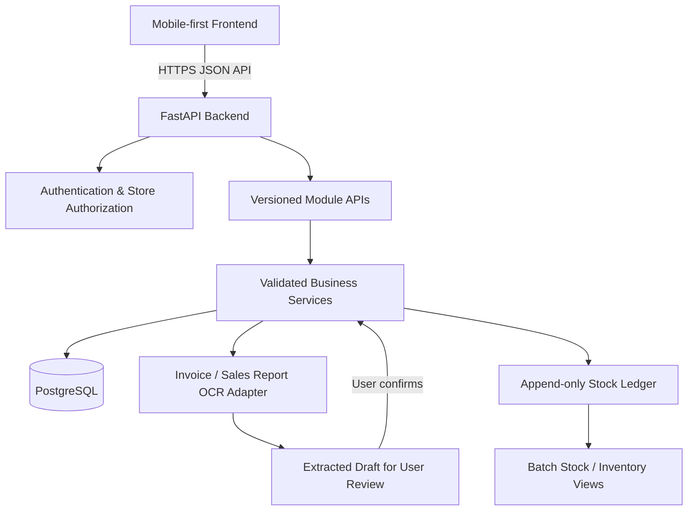

# Architecture

## Boundaries
- Frontend communicates with FastAPI; it never connects directly to PostgreSQL.
- API routers validate transport requests; business services enforce rules; database code handles persistence.
- OCR output is untrusted draft data. It does not mutate inventory until reviewed and explicitly confirmed.
- The inventory ledger is the stock movement history. A cached/current balance may be maintained, but it must remain consistent with the ledger.
- External integrations (OCR, WhatsApp, reminders) should sit behind adapters so provider changes do not leak through module code.

## Deployment note
Use a PostgreSQL deployment with transaction support. The backend initializes the `app_documents` JSONB persistence table and GIN index on startup; use `backend/scripts/setup_database.py` for explicit provisioning.
